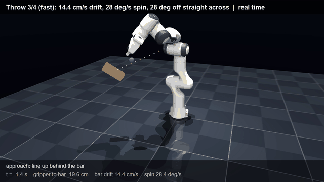
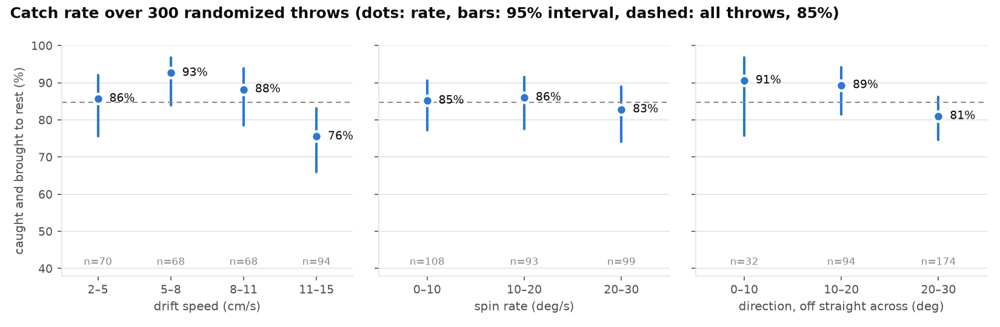
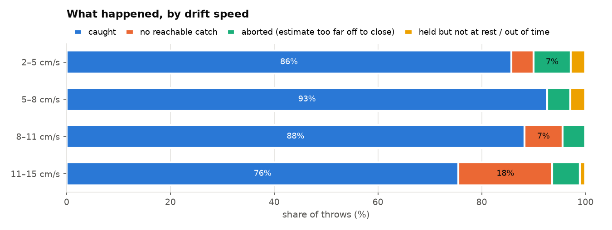
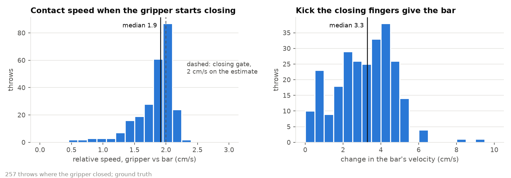
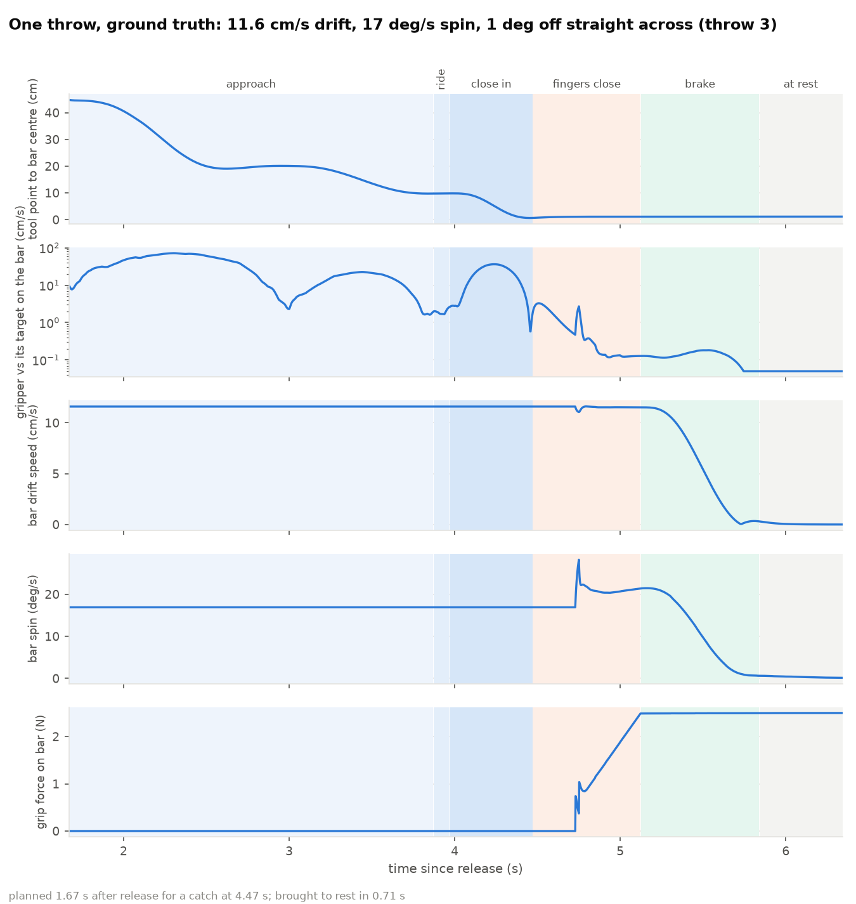

# Zero-G Catch

A fixed-base Franka Panda catches a drifting, tumbling object in zero gravity and brings it to
rest, using only a noisy pose sensor. Simulated in MuJoCo.



**85% of 300 randomized throws caught and brought to rest** (2–15 cm/s drift, 0–30°/s spin about
a random axis, from either side), with a median contact speed of 1.9 cm/s and 2.5 N of grip.

- One-page write-up: [docs/writeup.md](docs/writeup.md)
- Demo video (42 s): [docs/media/catch_demo.mp4](docs/media/catch_demo.mp4)

## How it works

1. **Estimate.** 30 Hz pose readings (5 mm / 2° noise, 5% dropout) → Kalman filter for position
   and velocity, sliding-window fit for spin.
2. **Plan.** Sweep capture times along the predicted path; pick the earliest grasp, square to a
   face of the bar, that the arm can reach in time and hold through the stop without nearing a
   singularity. Nothing reachable yet → try again every 0.5 s.
3. **Approach and ride along.** In the bar's moving, spinning frame: line up behind, ride along
   10 cm back, slide in matching drift and spin.
4. **Grasp only if it's safe.** Close only if the estimated miss is < 1 cm and < 2 cm/s, else back
   off and re-plan. Fingers close fast to just short of the bar, then slowly through contact.
5. **Stop gently.** Decelerate drift and spin together (≤ 0.3 m/s², ≤ 1 rad/s²) to rest.

## Results

Each throw draws speed, direction (within 30° of straight across, from either side), spin axis
and rate, start pose and sensor noise. "Caught" = bar between both fingers at < 0.5 cm/s and
< 2°/s, 0.5 s after the arm stops, from ground truth.

| | 300 throws |
|---|---|
| Caught and brought to rest | 85% (95% CI 80–88) |
| … given a reachable plan | 92% |
| … given the gripper started closing | 99% |
| Contact speed when closing, median / worst | 1.9 / 2.3 cm/s |
| Finger kick, slip in the grip, braking time (medians) | 3.3 cm/s, 0.75 mm, 0.68 s |






Spin hardly matters; speed does. The misses: 8% no reachable catch (the path never comes within
reach, or a fast throw passes faster than the arm can get there), 5% aborted at the grasp gate,
2% held but still turning or still retrying at the time limit.

## Setup

Python 3.12, MuJoCo 3.3+. The Panda model comes from
[MuJoCo Menagerie](https://github.com/google-deepmind/mujoco_menagerie) (not vendored).

```bash
uv venv --python 3.12 .venv
uv pip install --python .venv -r requirements.txt
git clone --depth 1 --filter=blob:none --sparse https://github.com/google-deepmind/mujoco_menagerie.git third_party/menagerie
git -C third_party/menagerie sparse-checkout set franka_emika_panda
```

## Run

With the virtual environment active (`.venv\Scripts\activate` on Windows,
`source .venv/bin/activate` elsewhere):

```bash
python -m scripts.view_catch        # the full catch, live, a new throw after each
python -m scripts.check_stop        # 30 throws end to end (one check per stage: scripts/check_*.py)
python -m scripts.monte_carlo --n 300 --workers 8 --out out/monte_carlo_300.csv
python -m scripts.plots             # figures from that CSV -> out/fig_*.png
python -m scripts.make_video        # -> out/catch_demo.mp4
```

300 throws take about 2.5 minutes on 8 cores.

## Layout

- `sim/scene.xml`: Panda + 5×5×15 cm, 0.5 kg bar on a free joint; gravity, drag and viscosity off.
- `sim/env.py`: environment, random throws, ground-truth state.
- `sim/sensor.py`: simulated pose sensor.
- `sim/estimator.py`: Kalman filter and spin fit.
- `sim/kinematics.py`: tool-point FK, damped least-squares IK, self-collision check.
- `sim/intercept.py`: intercept planner.
- `sim/catcher.py`: the controller and its phases (wait → approach → ride → close in → grasp →
  brake → stopped, or abort and re-plan).
- `sim/evaluate.py`: one throw end to end, scored against ground truth.
- `scripts/`: stage checks, live viewers, Monte Carlo, figures, video.

## Limits

The stop is position control with bounded deceleration, not force control (a wrist force/torque
sensor with admittance control is the next step). The approach clips at joint limits instead of
avoiding them, behind some of the aborts. Planning takes ~0.5 s of pure-Python IK while the
simulation waits. The object is a known rigid box and the sensor reports its pose directly.
